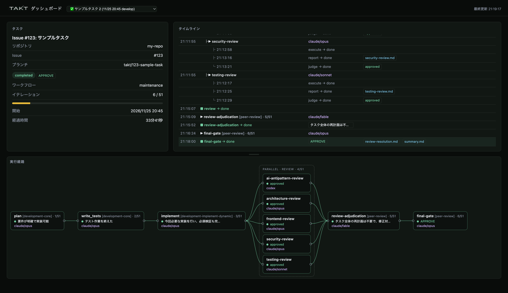
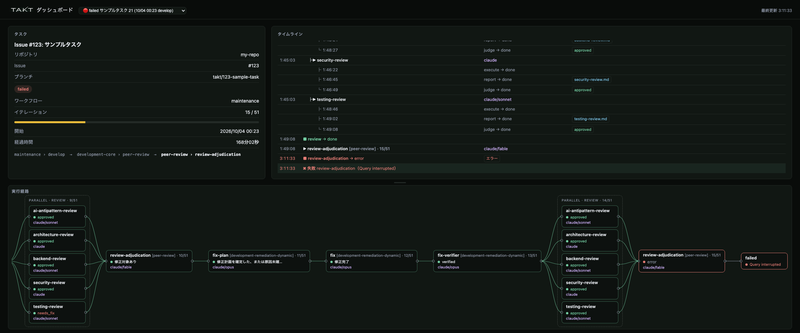

# takt-dashboard

[TAKT](https://github.com/nrslib/takt) の run をブラウザで見張るローカルダッシュボードです。
依存ライブラリなし（Node.js 標準ライブラリのみ）で動きます。
TAKT の公式ツールではなく、TAKT プロジェクトとは関係のない非公式のツールです。

[English](README.md)





## 5 分で試す

前提: Node.js 20 以上と、[TAKT](https://github.com/nrslib/takt) を使っているリポジトリ。

```bash
npm install -g takt-dashboard   # 1. インストール
cd /path/to/your-repo            # 2. takt を使っているリポジトリへ
takt-dashboard                   # 3. 起動
```

ブラウザで http://localhost:7331 を開くと、そのリポジトリの run が一覧で見えます。run がまだ無いときは「takt の run が見つかりません」と出ます。オプションや設定は「使い方」を見てください。

## できること

- **タイムライン**: ステップの開始・完了を時刻順に。並列ステップは子ごとに木にして、execute / report / judge の終了時刻を並べる。
- **判定結果**: 各ステップ・子の judge 結果（`approved` / `needs_fix` / 一致した rule 名）を行に表示。クリックで judge の理由（structured output の reason）を開く。
- **実行経路**: 公式 Web UI の実行経路に似たカード + ポート + 曲線の図。並列は枠の中に子を縦に並べ、リトライは枠が 2 つ並ぶ。
- **レート上限・リトライ**: `rate_limited` で中断 → リトライした経緯と、provider の切替（`codex/gpt-5 → claude/sonnet`）を開始行に表示。
- **中断・失敗**: プロセスが落ちて `running` のまま残った run を「中断」と判定し、どのステップで止まったかを終了行に出す。失敗は理由（`rule_no_match` など）と judge のエラーログ付き。
- **provider / model**: 並列の子はイベントに provider が無いので、takt の usage_events のログがあればそこから、無ければ run 開始時点の `~/.takt/runtime.yaml`（または `config.yaml`）から引く（詳しくは「過去の run の provider / model を正しく出すために」）。run ごとに結果を保存するので、後から yaml を変えても過去の表示は変わらない。
  - takt 本体と同じく `targets.steps` → `targets.tags` → `defaults` の順で引く。step の tag は workflow yaml の step の `tags:` から取り、これも run ごとに保存する。
- **レポート**: run の `reports/*.md` をステップに紐づけて一覧。クリックで本文を表示。
- 複数リポジトリ・worktree の run をまとめて一覧。2 秒ごとに自動更新。

## 使い方

```bash
npm install -g takt-dashboard   # takt-dashboard コマンドが入る（依存パッケージなし）

cd /path/to/your-repo    # takt を使っているリポジトリで
takt-dashboard           # → http://localhost:7331
```

公開版ではなく開発版（`main` ブランチ）を入れる場合は、`npm install -g github:kanae-chaika/takt-dashboard` を使います。

リポジトリで起動すると、そのリポジトリの `.takt/clone-meta/` と `.takt/tasks.yaml` から takt が作った worktree を辿って、run をまとめて一覧にします。`~/.takt`（`takt ui` から起動した run）も見ます。

takt の環境変数 `TAKT_CONFIG_DIR` を設定している場合は、takt と同じく `~/.takt` の代わりにそのディレクトリを読みます。この README の `~/.takt` は、そのディレクトリに読み替えてください（`runtime.yaml` / `config.yaml` とそのバックアップ、`workflows/`、`takt ui` から起動した run）。ダッシュボードを起動するシェルにも同じ `TAKT_CONFIG_DIR` を設定しておいてください。`TAKT_CONFIG_DIR` は絶対パスで指定してください。相対パスは takt とダッシュボードがそれぞれ起動時のカレントディレクトリから解決するので、起動したディレクトリが違うと別の場所を読みます。

| オプション | 説明 |
|---|---|
| `--roots ~/dev,~/projects` | 複数のリポジトリをまとめて見たいとき。リポジトリをまとめて置いているディレクトリを指定すると、その直下のリポジトリと worktree の `.takt/runs` を見る。カンマ区切りで複数指定できる |
| `--port N` | ポート（既定 7331） |
| `<run_dir>` | 表示する run ディレクトリを固定 |

毎回オプションを付けたくなければ、環境変数（`TAKT_DASHBOARD_ROOTS` / `TAKT_DASHBOARD_PORT`）か設定ファイルに書けます。優先順はコマンドライン > 環境変数 > 設定ファイル > 既定です。

```yaml
# ~/.config/takt-dashboard/config.yaml
roots:
  - ~/dev
port: 7331
```

## ダッシュボードが使うディレクトリ

`~/.config/takt-dashboard/` に自分のデータを置きます。takt 本体の `~/.takt/`（`TAKT_CONFIG_DIR` を設定している場合はそのディレクトリ）には書き込みません。

| ファイル | 内容 |
|---|---|
| `config.yaml` | 上の設定（任意） |
| `routing/<run slug>.json` | run ごとの provider 割り当ての控え（自動生成） |
| `takt-logo.svg` | ヘッダーのロゴを差し替えたいときだけ（任意）。通常は takt 本体に同梱のロゴ（`docs/assets/takt-logo-dark.svg`）を自動で使う |

## 別のマシンで回した run を見る

run ディレクトリ（`.takt/runs/<run>/`。`logs/` `meta.json` `reports/`）を zip などで持ってくれば、そのまま開けます。

```bash
takt-dashboard /path/to/<run>          # この run だけを表示
# いつもの画面で開くなら  http://localhost:7331/?run=/path/to/<run>
```

- `meta.json` の中のパスは相対なので、置き場所は自由です。
- `?run=` には、`\\host\share\…` や `//host/share/…` のようなネットワーク上のパス（先頭が `\` か `/` 2 つ）は指定できません（「指定した run が見つかりません」になります）。ネットワーク上の run は、手元にコピーして開くか、`<run_dir>` で指定してください。`--roots` などで一覧に入っている run は、ネットワーク上のパスでも開けます。
- 並列の子ステップの provider / model は、回したマシンの `~/.config/takt-dashboard/routing/<run>.json` を一緒にもらって同じ場所に置くと、回したマシンと同じ表示になります。この控えは、回したマシンが設定から引いた値です（設定のバックアップがあれば run 開始時点の設定、無ければ控えを作った時点の設定から引きます。設定から決まらないものは「?」）。無ければ手元の設定から引いた値になります。run のログに usage_events の記録があれば、どちらの場合もその値を優先します。

## 過去の run の provider / model を正しく出すために

並列の子ステップは、takt の実行ログ（`logs/*.jsonl` のイベント）に provider / model が記録されません。ダッシュボードは次の順で引きます。

1. takt の設定（`~/.takt/config.yaml`）で `logging.usage_events: true` にしている場合: 子の実行が終わるたびに、実際に使った provider / model が `logs/*-usage-events.jsonl` に書かれます。ダッシュボードはこれを最優先で使います（既定はオフ）。
2. それ以外（実行中でまだ記録が無い子を含む）: 設定ファイル（`~/.takt/runtime.yaml` または `config.yaml`）から引きます。

```yaml
# ~/.takt/config.yaml
logging:
  usage_events: true
```

`runtime.yaml` が次の書き方のときは、実際に使われた provider / model が設定からは決まらないので「?」と表示します（hover で理由を表示）。正確に出したい場合は `logging.usage_events` を有効にしてください。

- `ladder`（実行中に次の profile へ昇格することがある）・`pool`（実行時に router が選ぶ）
- `assignments`（名前付きの割り当て・実行時にどれを使うか選ばれる）
- `targets.personas`（`targets.steps` / `targets.tags` で名指ししていない step）

設定から引く場合、設定を後から変えると過去の run の表示が変わってしまいます。これを避けるため、`~/.takt/runtime.yaml` や `config.yaml` を変更するときは、変更前のファイルを次の名前で残しておくと、ダッシュボードが「run 開始時点で有効だった設定」を自動で選びます。

```
~/.takt/runtime.yaml.bak-20260301-change-review-model   # 変更前の内容。ファイルの更新時刻 = 置き換えた時刻
~/.takt/config.yaml.bak.20260101-add-codex
```

- `runtime.yaml.bak` / `config.yaml.bak` で始まる名前なら、後ろは自由
- 選んだ結果は `~/.config/takt-dashboard/routing/<run slug>.json` に保存され、以後は固定
- バックアップが無い場合は現在の設定値を使います（hover で「設定からの推定」と表示）

## 公式の Web UI（`takt ui`）との関係

takt 本体の Web UI（`takt ui`、`http://127.0.0.1:20525`）が一覧に出すのは、**その UI から起動した run だけ**です。このダッシュボードは、CLI（`takt run` / `takt watch`）で回した run も含めて**全部**を一覧にします（UI から起動したものは「UI:」付き）。

ダッシュボードは見るだけで、タスクの作成や PR・merge などの操作は公式 UI で行います。ポートが違うので両方を同時に動かせます。

## 注意

- TAKT の Web UI と run のログ形式は「実験的機能」で、予告なく変わります。takt **0.74.0**・**0.75.0**・**0.76.1** の実際の run のログで動作確認しています。provider の切替の通知文（日本語・英語）と `runtime.yaml` の `provider:` 配下の書き方は、takt 0.74.0 の mock provider（LLM を呼ばないテスト用の provider）で作った run で確認しています。0.75.0 の mock provider で作った run（完了・失敗・レート上限による provider の切替）も、0.74.0 と同じ表示になることを確認しています。**0.77.0** は、mock provider で作った同じ内容の run が 0.75.0・0.76.1 と同じ表示になることを確認しています（0.77.0 の実際の run では未確認です）。追従は約束しません。
- run のデータは worktree 側の `.takt/runs/` にあります。`takt list` でタスクを削除すると、その run はダッシュボードからも消えます。
- ローカル専用です（`localhost` にしか bind しません）。認証はありません。
- UI は日本語のみ。英語は予定。

## 開発する場合（通常は不要）

ダッシュボードのコード自体を改造したい場合だけ、`npm install -g` の代わりに clone して `npm link` します。`takt-dashboard` コマンドが clone 先を指すようになり、直した内容がそのまま反映されます。使うだけなら上の `npm install -g` で足ります。

```bash
git clone https://github.com/kanae-chaika/takt-dashboard.git
cd takt-dashboard && npm link
npm install        # テストと ESLint 用（実行時の依存は無い）
npm test
npm run lint
```

開発ツールの ESLint 10 は Node.js 20.19 以上 / 22.13 以上 / 24 以上が必要です（21 と 23 は対象外。使うだけなら 20 以上で動きます）。

## ライセンス

MIT
