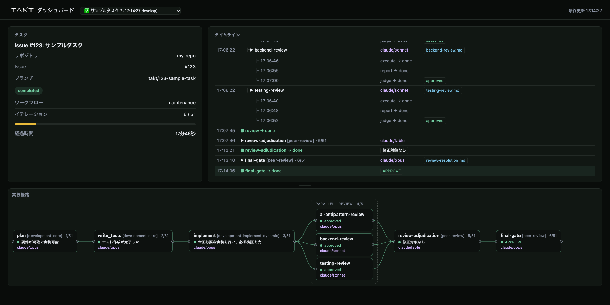
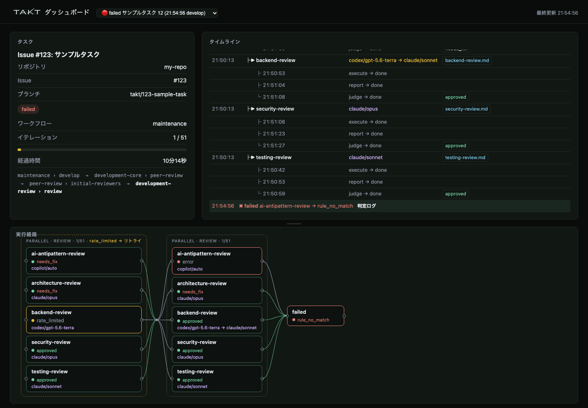

# takt-dashboard

[TAKT](https://github.com/nrslib/takt) の run をブラウザで見張るローカルダッシュボードです。
依存ライブラリなし（Node.js 標準ライブラリのみ）で動きます。
TAKT の公式ツールではなく、TAKT プロジェクトとは関係のない非公式のツールです。

[English](#english) is below.





## できること

- **タイムライン**: ステップの開始・完了を時刻順に。並列ステップは子ごとに木にして、execute / report / judge の終了時刻を並べる
- **判定結果**: 各ステップ・子の judge 結果（`approved` / `needs_fix` / 一致した rule 名）を行に表示。クリックで judge の理由（structured output の reason）を開く
- **実行経路**: 公式 Web UI の実行経路に似たカード + ポート + 曲線の図。並列は枠の中に子を縦に並べ、リトライは枠が 2 つ並ぶ
- **レート上限・リトライ**: `rate_limited` で中断 → リトライした経緯と、provider の切替（`codex/gpt-5 → claude/sonnet`）を開始行に表示
- **中断・失敗**: プロセスが落ちて `running` のまま残った run を「中断」と判定し、どのステップで止まったかを終了行に出す。失敗は理由（`rule_no_match` など）と judge のエラーログ付き
- **provider / model**: 並列の子はログに provider が無いので、run 開始時点の `~/.takt/runtime.yaml`（または `config.yaml`）から引く。run ごとに結果を保存するので、後から yaml を変えても過去の表示は変わらない
  - takt 本体と同じく `targets.steps` → `targets.tags` → `defaults` の順で引く。step の tag は workflow yaml の step の `tags:` から取り、これも run ごとに保存する
- **レポート**: run の `reports/*.md` をステップに紐づけて一覧。クリックで本文を表示
- 複数リポジトリ・worktree の run をまとめて一覧。2 秒ごとに自動更新

## 使い方

```bash
npm install -g github:kanae-chaika/takt-dashboard   # takt-dashboard コマンドが入る（依存パッケージなし）

cd /path/to/your-repo    # takt を使っているリポジトリで
takt-dashboard           # → http://localhost:7331
```

リポジトリで起動すると、そのリポジトリの `.takt/clone-meta/` と `.takt/tasks.yaml` から takt が作った worktree を辿って、run をまとめて一覧にします。`~/.takt`（`takt ui` から起動した run）も見ます。

| オプション | 説明 |
|---|---|
| `--roots ~/dev,~/projects` | 複数のリポジトリをまとめて見たいとき。リポジトリをまとめて置いているディレクトリを指定すると、その直下のリポジトリと worktree の `.takt/runs` を見る。カンマ区切りで複数指定できる |
| `--port N` | ポート（既定 7331） |
| `<run_dir>` | 表示する run ディレクトリを固定 |

毎回オプションを付けたくなければ、環境変数（`TAKT_DASHBOARD_ROOTS` / `TAKT_DASHBOARD_PORT`）か設定ファイルに書けます。優先順はコマンドライン > 環境変数 > 設定ファイル > 既定です。

```yaml
# ~/.config/takt-dashboard/config.yaml
roots:
  - ~/dev
port: 7331
```

## ダッシュボードが使うディレクトリ

`~/.config/takt-dashboard/` に自分のデータを置きます。takt 本体の `~/.takt/` には書き込みません。

| ファイル | 内容 |
|---|---|
| `config.yaml` | 上の設定（任意） |
| `routing/<run slug>.json` | run ごとの provider 割り当ての控え（自動生成） |
| `takt-logo.svg` | ヘッダーのロゴを差し替えたいときだけ（任意）。通常は takt 本体に同梱のロゴ（`docs/assets/takt-logo-dark.svg`）を自動で使う |

## 別のマシンで回した run を見る

run ディレクトリ（`.takt/runs/<run>/`。`logs/` `meta.json` `reports/`）を zip などで持ってくれば、そのまま開けます。

```bash
takt-dashboard /path/to/<run>          # この run だけを表示
# いつもの画面で開くなら  http://localhost:7331/?run=/path/to/<run>
```

- `meta.json` の中のパスは相対なので、置き場所は自由です
- `?run=` には、`\\host\share\…` や `//host/share/…` のようなネットワーク上のパス（先頭が `\` か `/` 2 つ）は指定できません（「指定した run が見つかりません」になります）。ネットワーク上の run は、手元にコピーして開くか、`<run_dir>` で指定してください。`--roots` などで一覧に入っている run は、ネットワーク上のパスでも開けます
- 並列の子ステップの provider / model は、回したマシンの `~/.config/takt-dashboard/routing/<run>.json` を一緒にもらって同じ場所に置くと正しく出ます。無ければ手元の設定から引いた値になります

## 過去の run の provider / model を正しく出すために

並列の子ステップは takt のログに provider / model が記録されません。そのため設定ファイルから引きますが、設定を後から変えると過去の run の表示が変わってしまいます。

これを避けるため、`~/.takt/runtime.yaml` や `config.yaml` を変更するときは、変更前のファイルを次の名前で残しておくと、ダッシュボードが「run 開始時点で有効だった設定」を自動で選びます。

```
~/.takt/runtime.yaml.bak-20260301-change-review-model   # 変更前の内容。ファイルの更新時刻 = 置き換えた時刻
~/.takt/config.yaml.bak.20260101-add-codex
```

- `runtime.yaml.bak` / `config.yaml.bak` で始まる名前なら、後ろは自由
- 選んだ結果は `~/.config/takt-dashboard/routing/<run slug>.json` に保存され、以後は固定
- バックアップが無い場合は現在の設定値を使います（hover で「設定からの推定」と表示）

## 公式の Web UI（`takt ui`）との関係

takt 本体の Web UI（`takt ui`、`http://127.0.0.1:20525`）が一覧に出すのは、**その UI から起動した run だけ**です。このダッシュボードは、CLI（`takt run` / `takt watch`）で回した run も含めて**全部**を一覧にします（UI から起動したものは「UI:」付き）。

ダッシュボードは見るだけで、タスクの作成や PR・merge などの操作は公式 UI で行います。ポートが違うので両方を同時に動かせます。

## 注意

- TAKT の Web UI と run のログ形式は「実験的機能」で、予告なく変わります。takt **0.73.0** のログで動作確認しています（provider の切替の通知文は、takt 0.74.0 の日本語・英語の形式に対応）。追従は約束しません
- run のデータは worktree 側の `.takt/runs/` にあります。`takt list` でタスクを削除すると、その run はダッシュボードからも消えます
- ローカル専用です（`localhost` にしか bind しません）。認証はありません
- UI は日本語のみ。英語は予定

## 開発する場合（通常は不要）

ダッシュボードのコード自体を改造したい場合だけ、`npm install -g` の代わりに clone して `npm link` します。`takt-dashboard` コマンドが clone 先を指すようになり、直した内容がそのまま反映されます。使うだけなら上の `npm install -g` で足ります。

```bash
git clone https://github.com/kanae-chaika/takt-dashboard.git
cd takt-dashboard && npm link
npm install        # テストと ESLint 用（実行時の依存は無い）
npm test
npm run lint
```

開発ツールの ESLint 10 は Node.js 20.19 以上 / 22.13 以上 / 24 以上が必要です（21 と 23 は対象外。使うだけなら 20 以上で動きます）。

## ライセンス

MIT

---

## English

A local web dashboard for watching [TAKT](https://github.com/nrslib/takt) runs. No dependencies (Node.js standard library only). This is an unofficial tool and is not affiliated with the TAKT project.

**Features**

- Timeline of step starts/ends; parallel steps are grouped per child with execute / report / judge end times
- Judge results per step (`approved`, `needs_fix`, matched rule name) inline; click to see the judge's reason
- Execution path view (cards, ports and curves) similar to the official Web UI, including parallel fan-out and retries
- Rate-limit interruptions, retries and provider switches shown on the step's start row
- Detects runs whose process died while `running` and marks them "interrupted" with the step that was in flight; failed runs show the reason and the judge error log
- Resolves provider/model for parallel children from `~/.takt/runtime.yaml` (or `config.yaml`) **as of the run's start time**, using dated backups (`runtime.yaml.bak-*`, `config.yaml.bak.*`) when present; the result is saved per run under `~/.config/takt-dashboard/routing/`. Like takt itself, it checks `targets.steps`, then `targets.tags` (matched against the step's `tags:` in the workflow yaml, also saved per run), then `defaults`
- Lists runs across multiple repositories and worktrees; refreshes every 2 seconds

**Usage**

```bash
npm install -g github:kanae-chaika/takt-dashboard   # installs the takt-dashboard command (no dependencies)

cd /path/to/your-repo    # a repository where you use takt
takt-dashboard           # → http://localhost:7331
```

Started inside a repository, it follows the worktrees takt created (from `.takt/clone-meta/` and `.takt/tasks.yaml`) and lists all their runs, plus runs under `~/.takt` (started from `takt ui`).

| Option | Description |
|---|---|
| `--roots ~/dev,~/projects` | To watch several repositories at once: give the directory that holds your repositories; its immediate subdirectories (repositories and worktrees) are checked for `.takt/runs`. Several directories can be given, comma-separated |
| `--port N` | Port (default 7331) |
| `<run_dir>` | Pin a specific run directory |

Both can also be set with environment variables (`TAKT_DASHBOARD_ROOTS`, `TAKT_DASHBOARD_PORT`) or in `~/.config/takt-dashboard/config.yaml` (`roots:` list and `port:`); command line > environment > config file > defaults. The dashboard keeps its own data there (`routing/` snapshots, optional `takt-logo.svg` override) and never writes into takt's `~/.takt/`. The header logo is read from the installed takt package (`docs/assets/takt-logo-dark.svg`).

**Relation to the official Web UI**: takt's own Web UI (`takt ui`, `http://127.0.0.1:20525`) lists only the runs started from that UI. This dashboard lists all runs, including those started from the CLI (`takt run` / `takt watch`); UI-started runs are prefixed "UI:". The dashboard is read-only; task creation and branch/PR actions stay in the official UI. Both can run at the same time (different ports).

**Viewing a run from another machine**: copy its run directory (`.takt/runs/<run>/` with `logs/`, `meta.json`, `reports/`) and open it with `takt-dashboard /path/to/<run>` or `?run=/path/to/<run>`. Paths inside `meta.json` are relative, so location does not matter. `?run=` does not accept network paths (starting with two `\` or `/`, such as `\\host\share\…` or `//host/share/…`); they are reported as not found. Copy such a run to a local disk or pass it as `<run_dir>` instead. Runs already in the list (for example via `--roots`) open even when their path is a network path. Bring that machine's `~/.config/takt-dashboard/routing/<run>.json` along to show the providers it actually used for parallel children.

**Caveats**: the UI text is Japanese only for now (English is planned). TAKT's run log format is experimental and may change; verified against takt 0.73.0 logs (provider-switch notices are read in both the Japanese and English formats of takt 0.74.0). Run data lives in each worktree's `.takt/runs/`, so deleting a task in `takt list` removes it from the dashboard too. Binds to localhost only, no authentication.

**Development (not needed for normal use)**: only if you want to modify the dashboard itself, clone the repository and run `npm link` instead of `npm install -g`; the `takt-dashboard` command then points at your checkout. `npm install` brings in the dev tooling (there are no runtime dependencies); `npm test` runs the tests and `npm run lint` runs ESLint. The dev tooling (ESLint 10) needs Node.js 20.19+, 22.13+ or 24+ (21 and 23 are not supported); running the dashboard itself only needs Node.js 20+.

License: MIT
