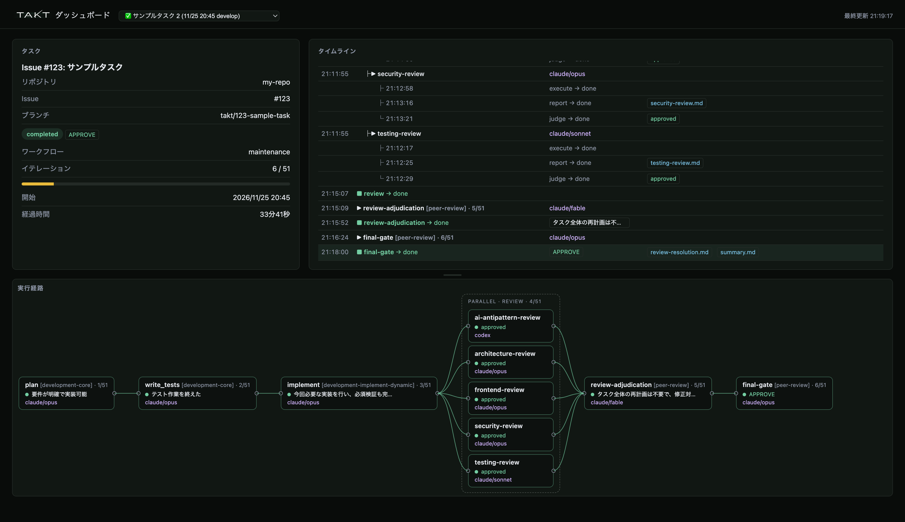
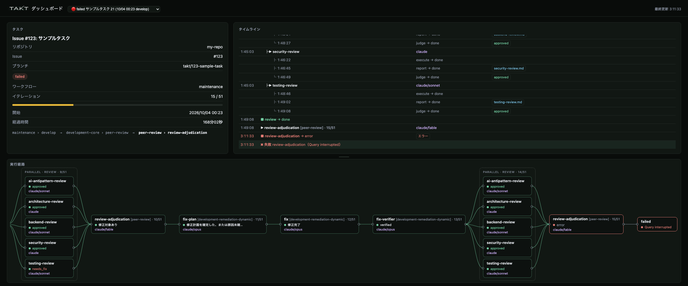

# takt-dashboard

A local web dashboard for watching [TAKT](https://github.com/nrslib/takt) runs in your browser.
It has no dependencies (Node.js standard library only).
This is an unofficial tool and is not affiliated with the TAKT project.

[日本語](README.ja.md)





## Try it in 5 minutes

Requires Node.js 20 or later and a repository where you use [TAKT](https://github.com/nrslib/takt).

```bash
npm install -g takt-dashboard   # 1. install
cd /path/to/your-repo            # 2. go to a repository where you use takt
takt-dashboard                   # 3. start
```

Open http://localhost:7331 in your browser to see that repository's runs. If there are no runs yet, it shows "takt の run が見つかりません" (no takt runs found). See "Usage" for options and settings.

The UI text is Japanese only for now. This README quotes on-screen text as it appears and adds a translation.

## Features

- **Timeline**: step starts and ends in time order. A parallel step is shown as a tree with one branch per child, listing the end times of execute / report / judge.
- **Judge results**: the judge result of each step and child (`approved` / `needs_fix` / the name of the matched rule) is shown on its row. Click it to open the judge's reason (the `reason` of the structured output).
- **Execution path**: a diagram of cards, ports and curves, similar to the execution path in the official Web UI. A parallel step is a frame with its children stacked inside; a retry shows two frames side by side.
- **Rate limits and retries**: when a step is interrupted by `rate_limited` and retried, the start row shows what happened, including the provider switch (`codex/gpt-5 → claude/sonnet`).
- **Interrupted and failed runs**: a run whose process died and was left as `running` is detected as "中断" (interrupted), and the end row shows which step it stopped at. A failed run shows the reason (such as `rule_no_match`) and the judge's error log.
- **provider / model**: takt's events do not record the provider for parallel children, so the dashboard takes it from takt's usage_events log when there is one, and otherwise from `~/.takt/runtime.yaml` (or `config.yaml`) as of the run's start (see "Showing the right provider / model for past runs"). The result is saved per run, so changing the yaml later does not change how past runs are shown.
  - Like takt itself, it looks up `targets.steps` → `targets.tags` → `defaults`, in that order. A step's tags come from the step's `tags:` in the workflow yaml, and are also saved per run.
- **Reports**: the run's `reports/*.md` are listed with the step they belong to. Click one to read it. Reports open as a Markdown preview; the "プレビュー" (preview) / "元のテキスト" (original text) buttons switch between the preview and the raw text.
- Runs from several repositories and worktrees are listed together. The page refreshes every 2 seconds.

## Usage

```bash
npm install -g takt-dashboard   # installs the takt-dashboard command (no dependencies)

cd /path/to/your-repo    # a repository where you use takt
takt-dashboard           # → http://localhost:7331
```

To install the development version (the `main` branch) instead of the published one, use `npm install -g github:kanae-chaika/takt-dashboard`.

Started inside a repository, the dashboard follows the worktrees takt created (from that repository's `.takt/clone-meta/` and `.takt/tasks.yaml`) and lists all their runs together. It also reads `~/.takt` (runs started from `takt ui`).

If you set takt's `TAKT_CONFIG_DIR` environment variable, the dashboard reads that directory instead of `~/.takt`, as takt does. Read every `~/.takt` in this README as that directory (`runtime.yaml` / `config.yaml` and their backups, `workflows/`, and runs started from `takt ui`). Set the same `TAKT_CONFIG_DIR` in the shell that starts the dashboard. Use an absolute path: takt and the dashboard each resolve a relative path from the directory they were started in, so they read different places when started from different directories.

| Option | Description |
|---|---|
| `--roots ~/dev,~/projects` | To watch several repositories at once. Give the directory that holds your repositories; the dashboard checks the repositories and worktrees directly under it for `.takt/runs`. Several directories can be given, comma-separated |
| `--port N` | Port (default 7331) |
| `<run_dir>` | Pin the run directory to show |

If you do not want to pass options every time, set them with environment variables (`TAKT_DASHBOARD_ROOTS` / `TAKT_DASHBOARD_PORT`) or in the config file. The order of precedence is command line > environment variables > config file > defaults.

```yaml
# ~/.config/takt-dashboard/config.yaml
roots:
  - ~/dev
port: 7331
```

## Directories the dashboard uses

The dashboard keeps its own data in `~/.config/takt-dashboard/`. It never writes into takt's `~/.takt/` (or the `TAKT_CONFIG_DIR` directory, if you set it).

| File | Contents |
|---|---|
| `config.yaml` | The settings above (optional) |
| `routing/<run slug>.json` | The provider assignments recorded for each run (generated automatically) |
| `takt-logo.svg` | Only if you want to replace the header logo (optional). Normally the logo bundled with takt (`docs/assets/takt-logo-dark.svg`) is used automatically |

## Viewing a run from another machine

Bring the run directory (`.takt/runs/<run>/`, with `logs/`, `meta.json` and `reports/`) over, as a zip for example, and open it as it is.

```bash
takt-dashboard /path/to/<run>          # show only this run
# to open it in the usual screen:  http://localhost:7331/?run=/path/to/<run>
```

- The paths inside `meta.json` are relative, so you can put the directory anywhere.
- `?run=` does not accept network paths such as `\\host\share\…` or `//host/share/…` (paths that start with two `\` or `/`). They are reported as "指定した run が見つかりません" (the specified run was not found). Copy such a run to a local disk, or pass it as `<run_dir>`. Runs that are already in the list (through `--roots`, for example) open even when their path is a network path.
- To show the provider / model of parallel children the same way as on the machine that ran it, bring that machine's `~/.config/takt-dashboard/routing/<run>.json` along and put it in the same place. That file holds what that machine resolved from its config (the config as of the run's start when config backups exist, otherwise the config at the time the file was written; "?" where the config does not determine it). Without the file, the values come from your local config. When the run's logs contain usage_events records, those take precedence in both cases.

## Showing the right provider / model for past runs

takt's run log (the events in `logs/*.jsonl`) does not record the provider / model of parallel children. The dashboard looks them up in this order.

1. If `logging.usage_events: true` is set in takt's config (`~/.takt/config.yaml`): each time a child finishes, the provider / model actually used is written to `logs/*-usage-events.jsonl`. The dashboard uses this first (it is off by default).
2. Otherwise (including children that are still running and have no record yet): it resolves them from the config files (`~/.takt/runtime.yaml` or `config.yaml`).

```yaml
# ~/.takt/config.yaml
logging:
  usage_events: true
```

When `runtime.yaml` uses any of the following, the provider / model actually used cannot be determined from the config, so the dashboard shows "?" (hover over it to see why). Enable `logging.usage_events` if you want the exact values.

- `ladder` (may be promoted to the next profile during the run) and `pool` (a router picks one at run time)
- `assignments` (named assignments; which one is used is chosen at run time)
- `targets.personas` (for steps that are not named in `targets.steps` / `targets.tags`)

When the values are resolved from the config, changing the config later would change how past runs are shown. To avoid this, when you change `~/.takt/runtime.yaml` or `config.yaml`, keep the file as it was before the change under a name like the following. The dashboard then picks the config that was in effect when the run started.

```
~/.takt/runtime.yaml.bak-20260301-change-review-model   # the contents before the change; the file's modification time = when it was replaced
~/.takt/config.yaml.bak.20260101-add-codex
```

- Any name that starts with `runtime.yaml.bak` / `config.yaml.bak` works; the rest is up to you.
- The result is saved in `~/.config/takt-dashboard/routing/<run slug>.json` and stays fixed from then on.
- Without a backup, the current config is used (hovering shows "設定…からの推定", estimated from the config).

## Relation to the official Web UI (`takt ui`)

takt's own Web UI (`takt ui`, `http://127.0.0.1:20525`) lists **only the runs started from that UI**. This dashboard lists **all** runs, including those run from the CLI (`takt run` / `takt watch`). Runs started from the UI are prefixed "UI:".

The dashboard is read-only. Creating tasks and actions such as PRs and merges are done in the official UI. The two use different ports, so you can run both at the same time.

## Caveats

- TAKT's Web UI and run log format are experimental features and change without notice. The dashboard is verified against the logs of real runs made with takt **0.74.0**, **0.75.0** and **0.76.1**. The provider-switch notices (Japanese and English) and the notation under `provider:` in `runtime.yaml` were checked with runs made by takt 0.74.0's mock provider (a test provider that does not call an LLM). Runs made with 0.75.0's mock provider (a completed run, a failed run, and a provider switch on a rate limit) are displayed the same as with 0.74.0. For **0.77.0**, the same runs made with its mock provider are displayed the same as with 0.75.0 and 0.76.1 (not yet checked with real 0.77.0 runs). Keeping up with future takt versions is not promised.
- Run data lives in each worktree's `.takt/runs/`. Deleting a task in `takt list` removes its run from the dashboard too.
- Local use only (it binds to `localhost` only). There is no authentication.
- The UI is Japanese only. English is planned.

## Development (not needed for normal use)

Only if you want to modify the dashboard's own code, clone the repository and run `npm link` instead of `npm install -g`. The `takt-dashboard` command then points at your clone, and your changes take effect as they are. To just use the dashboard, `npm install -g` above is enough.

```bash
git clone https://github.com/kanae-chaika/takt-dashboard.git
cd takt-dashboard && npm link
npm install        # for the tests and ESLint (there are no runtime dependencies)
npm test
npm run lint
```

The development tooling (ESLint 10) needs Node.js 20.19 or later / 22.13 or later / 24 or later (21 and 23 are not supported; just using the dashboard works with 20 or later).

## License

MIT
